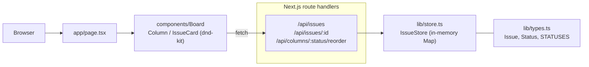

# PipelineFlow (Issue Tracker)

A minimal kanban-style tracker built with Next.js 15 (App Router) + TypeScript.
Cases ("issues") are stored in an in-memory `Map` (`lib/store.ts`) and reset on
server restart. There is no database — do not add one.

Training framing: each issue is a loan/claims case moving through a pipeline.

| Status key    | Pipeline stage   |
| ------------- | ---------------- |
| `backlog`     | Submitted        |
| `todo`        | Document Review  |
| `in_progress` | Underwriting     |
| `done`        | Decisioned       |

Only these four keys (`STATUSES` in `lib/types.ts`) are valid statuses.

## Getting started

Requires Node 20+ and npm.

```bash
npm ci
npm run dev        # http://localhost:3000
```

| Command             | Purpose                     |
| ------------------- | --------------------------- |
| `npm run dev`       | Start dev server            |
| `npm run build`     | Production build            |
| `npm run typecheck` | `tsc --noEmit`              |
| `npm test`          | Run unit tests (vitest)     |

Run `npm run typecheck && npm test` before declaring work complete.

## Architecture flow



Drag-and-drop on the board calls `PATCH /api/issues/:id` (status change) or
`PUT /api/columns/:status/reorder` (ordering); the store is the single source
of truth.

## Testing

Tests live next to code as `*.test.ts` and run with vitest (`npm test`).
`lib/store.test.ts` covers seeding, default status, ordering, moving between
columns, reordering, and unknown-id handling.

## API

- `GET /api/issues`
- `POST /api/issues` — `{ title, description?, status? }`
- `GET /api/issues/:id`
- `PATCH /api/issues/:id` — `{ title?, description?, status?, order? }`
- `DELETE /api/issues/:id`
- `PUT /api/columns/:status/reorder` — `{ orderedIds: string[] }`

> Known gap: the API routes do not yet validate `status` against `STATUSES`.
