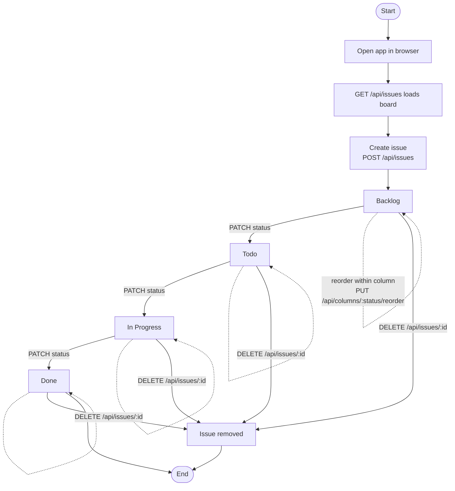

# Issue Tracker

A minimal kanban-style issue tracker built with Next.js. Issues are stored in memory and reset on server restart.

## Setup

```bash

curl -fsSL https://bun.com/install | bash

bun install
bun run dev
```

Open http://localhost:3000.

## API

- `GET /api/issues`
- `POST /api/issues` — `{ title, description?, status? }`
- `PATCH /api/issues/:id` — `{ title?, description?, status?, order? }`
- `DELETE /api/issues/:id`
- `PUT /api/columns/:status/reorder` — `{ orderedIds: string[] }`

## Flow Diagram

End-to-end flow of an issue from creation to completion:


